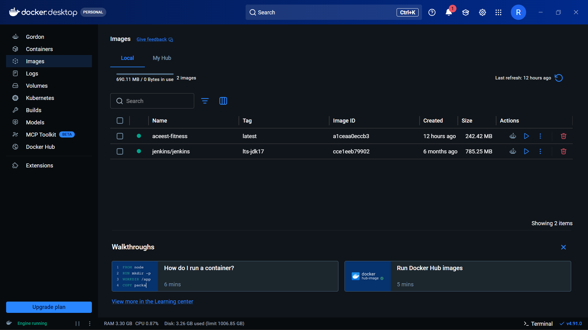
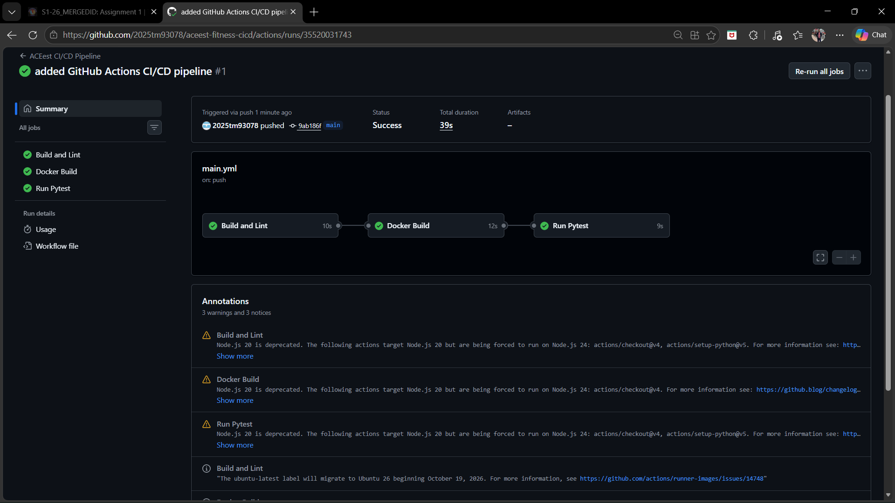
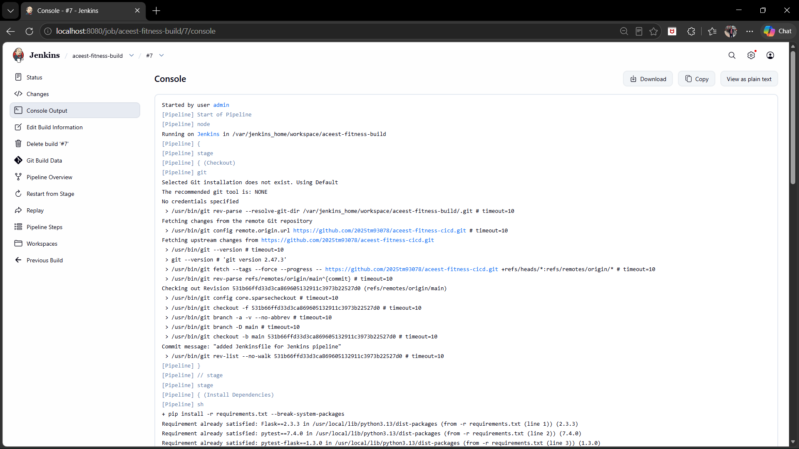
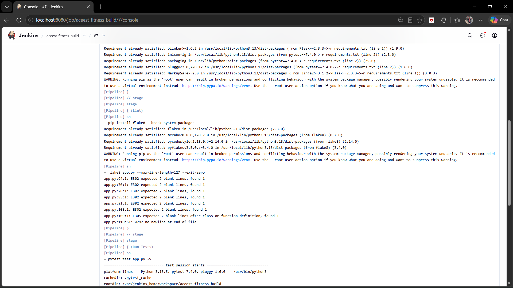
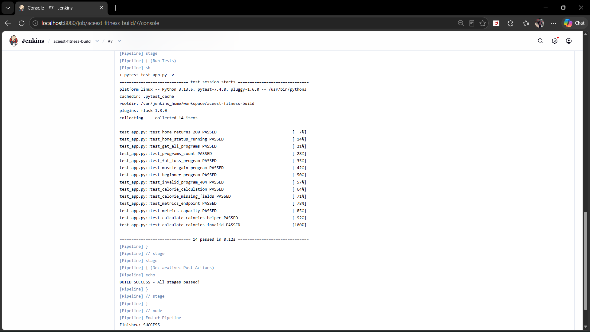

# ACEest Fitness & Gym

## What is this project
This is a Flask web app for ACEest Fitness and Gym. It has API endpoints for fitness programs, diet plans, workouts and calorie calculation. I also set up a full CI/CD pipeline using GitHub Actions and Jenkins.

## How to run locally
```bash
git clone https://github.com/2025tm93078/aceest-fitness-cicd.git
cd aceest-fitness-cicd
pip install -r requirements.txt
python app.py
```
Open http://localhost:5000 in browser

## API Endpoints
- GET / — checks if app is running
- GET /programs — shows all fitness programs
- GET /programs/<id> — shows one program
- GET /programs/<id>/diet — shows diet plan
- GET /programs/<id>/workout — shows workout plan
- POST /calories — calculates daily calories based on weight
- GET /metrics — shows gym details

## Running tests
```bash
pytest test_app.py -v
```
18 tests, all passing.

## Docker
```bash
docker build -t aceest-fitness .
docker run -p 5000:5000 aceest-fitness
```



## GitHub Actions
Pipeline runs automatically on every push to main. It does 3 things - lint check, docker build, and runs all tests.



## Jenkins
Jenkins pulls code from GitHub and runs the build. Stages are checkout, install, lint and test.




## Assignment 2: CI/CD, Docker Hub and Kubernetes

**Docker Hub:** https://hub.docker.com/r/rohitvardhanbattula/aceest-fitness (tags: v1.0, v2.0, v3.0, latest, build numbers)

**Pipeline (Jenkinsfile):** SCM polling, install, flake8 lint, pytest, SonarQube analysis, Docker build, tests inside the container, push to Docker Hub.

**Kubernetes manifests (`k8s/`), run on Minikube:**

| Strategy | File | How it works |
|---|---|---|
| Rolling update + rollback | rolling.yaml | v1.0 to v2.0 with maxUnavailable 0, `kubectl rollout undo` |
| Blue-Green | bluegreen.yaml | Service selector switches blue (v1.0) to green (v2.0) |
| Canary | canary.yaml | 3 stable (v1.0) and 1 canary (v2.0) pods behind one Service |
| Shadow | shadow.yaml | nginx mirrors traffic to v2.0, users only see v1.0 |
| A/B testing | abtest.yaml | Header `X-Group: B` routes to v2.0 |

**Version history:** `versions/` holds the original ACEest Tkinter versions (1.0 to 3.2.4). Git tags v1.0, v2.0 and v3.0 mark the releases.

**Endpoints (Minikube NodePorts):** rolling 30001, blue-green 30002, canary 30003, shadow 30004, A/B 30005. Access with `minikube service <name> --url`.
